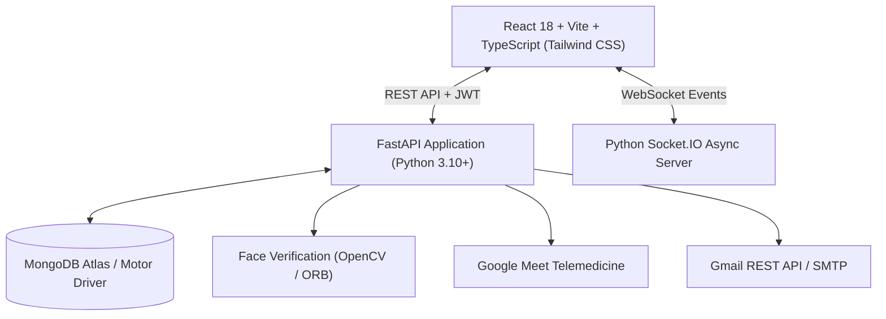

# MedChain 🏥

[](https://fastapi.tiangolo.com)
[](https://reactjs.org/)
[](https://www.typescriptlang.org/)
[](https://tailwindcss.com/)
[](https://www.mongodb.com/atlas)
[](https://socket.io/)
[](LICENSE)

**MedChain** is a full-stack, enterprise-grade Healthcare and Telemedicine web application designed to connect patients, licensed clinicians, and healthcare administrators. MedChain combines multi-modal biometric authentication (facial verification + passwordless login), digital health record vaults, automated video consultations with genuine Google Meet rooms, and real-time clinician messaging with robust server-side security.

---

## 📑 Table of Contents

- [Key Features](#-key-features)
- [Architecture & Tech Stack](#-architecture--tech-stack)
- [Security & Access Control Highlights](#-security--access-control-highlights)
- [Project Structure](#-project-structure)
- [Getting Started](#-getting-started)
  - [Prerequisites](#prerequisites)
  - [Installation](#installation)
  - [Configuration](#configuration)
  - [Running the Application](#running-the-application)
- [Running Automated Security Tests](#-running-automated-security-tests)
- [API Documentation](#-api-documentation)
- [License](#-license)

---

## ✨ Key Features

### 1. 🔐 Biometric & Multi-Factor Authentication
- **Client-Side Face Detection**: Powered by `face-api.js` (SSD MobileNet) with clean hardware webcam lifecycle management that automatically turns off hardware LEDs upon capture/cancel.
- **Backend Facial Verification**: Multi-scale template cross-correlation and ORB descriptor matching using OpenCV to verify facial embeddings against enrolled patient profiles.
- **Role-Based Portals**: Dedicated access control for **Patients**, **Doctors**, and **Administrators**.

### 2. 🩺 Comprehensive Doctor Portal
- **Clinical Overview**: Live consultation stats, today's schedule, pending appointments, and patient overview.
- **Strict Doctor-Patient Authorization**: Clinicians can only inspect patient details and history for individuals with whom they have an active or scheduled appointment.
- **Slot Availability Scheduler**: Configure weekly availability windows and custom time slots.
- **Telemedicine Integration**: Automatic genuine Google Meet room provisioning (`meet.google.com/new` or custom permanent clinical meet rooms).
- **Electronic Prescriptions**: Draft structured medication prescriptions with dosages, schedules, and duration.

### 3. 👤 Patient Health Portal & Digital Vault
- **Vitals Tracking**: Interactive logging for Resting Heart Rate (BPM), Blood Pressure (mmHg), Body Weight (kg), and Daily Steps.
- **Encrypted Health Vault**: Upload and store medical records (Prescriptions, Lab Results, Diagnoses, Vaccinations) with multi-format attachments (`.pdf`, `.jpg`, `.png`, `.docx`).
- **Private Attachment Streaming**: Attachments are served exclusively through authenticated endpoints, completely preventing unauthenticated public static file exposure.
- **Digital Pharmacy**: Browse medication inventory, check dosages, view pricing, and request digital prescription refills.

### 4. 🛡️ Administrator Oversight & Clinician Verification
- **Medical Credential Verification**: Review submitted doctor government IDs, state medical license numbers, and years of experience.
- **Authenticated ID Preview Modal**: High-resolution, secured preview for both image-based and PDF credentials before approving or revoking doctor privileges.
- **Audit Enforcement**: Doctor accounts remain blocked from clinical endpoints until verified and approved by an administrator.

### 5. 💬 Real-Time Messaging & Notifications
- **Private Socket.IO Chat**: Instant, bidirectional messaging between assigned patients and doctors with delivery state tracking and deduplication.
- **Automated Email Dispatch**: Appointment confirmations and schedule updates dispatched via OAuth2 Gmail REST API or standard SMTP.

---

## 🏛 Architecture & Tech Stack



| Layer | Technologies |
| :--- | :--- |
| **Frontend** | React 18, TypeScript, Vite, Tailwind CSS, Lucide React, Axios, Socket.IO-Client, React Hot Toast |
| **Backend API** | Python 3.10+, FastAPI, Starlette, Uvicorn, Pydantic, PyJWT, Bcrypt |
| **Realtime Engine** | Python-SocketIO, Engine.IO, WebSockets |
| **Database** | MongoDB Atlas (Async Motor Driver with TLS CA certs) + Local JSON store for offline dev |
| **Computer Vision** | OpenCV (cv2), NumPy, Pillow, face-api.js |
| **Testing** | Python `unittest`, Pytest, Starlette TestClient |

---

## 🔒 Security & Access Control Highlights

MedChain is built with strict privacy and access-control boundaries:

- **Zero Tracked Secrets & Uploads**: The repository history is cleaned and strictly configured via `.gitignore` to prevent committing `.env` files, credentials, or private uploads.
- **Fail-Fast Production JWT Secret**: The backend halts startup in production if `JWT_SECRET` is unset, default, or less than 32 characters.
- **Strict Role-Based Access Control (RBAC)**:
  - Admin tokens are verified against trusted database records and environment credentials.
  - Doctor clinical endpoints enforce `require_verified_doctor` to reject pending, rejected, or revoked doctors.
  - Cross-patient record access (IDOR) is blocked (`403 Forbidden`).
- **No Public Static Mounts of Private Files**: The `/uploads` static file mount was removed to protect private medical records and IDs from unauthorized URL guessing.
- **Upload Validation & Path Traversal Protection**: Uploaded files are strictly validated by extension, MIME type, and size limits (10MB for records, 5MB for IDs/faces), while filenames are sanitized against path traversal (`../`).
- **Strict CORS Policy**: Disallows wildcard `*` when credentials are enabled.

---

## 📂 Project Structure

```text
MedChain/
├── backend/
│   ├── app/
│   │   ├── auth/              # Security dependencies, JWT handling, facial verification
│   │   ├── routers/           # FastAPI modular endpoints
│   │   │   ├── admin.py       # Doctor credential review & verification
│   │   │   ├── appointments.py# Booking, schedule management, Google Meet integration
│   │   │   ├── auth.py        # Registration, passwords, biometric face login
│   │   │   ├── doctors.py     # Clinician directory, schedule, patient management
│   │   │   ├── medical_records.py # Health vault, authorized attachment downloads
│   │   │   ├── messages.py    # Private clinical messaging history
│   │   │   ├── patients.py    # Patient profile, vitals metrics, prescriptions
│   │   │   └── pharmacy.py    # Medication catalog & dispensary
│   │   ├── services/          # Socket.IO service, upload validator, email client
│   │   ├── config.py          # Environment settings, CORS, upload directories
│   │   ├── database.py        # Motor async MongoDB manager & resilient store
│   │   └── main.py            # FastAPI application entrypoint & middleware
│   ├── tests/                 # Automated security & authorization test suite
│   │   └── test_security.py
│   └── run.py                 # Development runner with automatic port discovery
├── src/                       # React frontend
│   ├── components/            # Reusable UI components (Vitals, Health Vault, Chat)
│   ├── pages/                 # Patient, Doctor, Admin dashboards & auth flows
│   ├── services/              # Axios API client & Socket.IO client
│   └── App.tsx                # Client-side routing and protected route wrappers
├── public/models/             # Public weights for client-side face bounding detection
├── .env.example               # Configuration template
├── package.json               # Node.js dependencies and scripts
└── vite.config.ts             # Vite configuration with proxy settings
```

---

## 🚀 Getting Started

### Prerequisites

- **Node.js**: v18.0.0 or higher
- **Python**: v3.10 or higher
- **MongoDB**: An active [MongoDB Atlas](https://www.mongodb.com/atlas) cluster URI (or local MongoDB instance)

### Installation

1. **Clone the repository**:
   ```bash
   git clone https://github.com/Harsh-Rupesh-Shah/MedChain.git
   cd MedChain
   ```

2. **Install Frontend Dependencies**:
   ```bash
   npm install
   ```

3. **Set up Python Virtual Environment**:
   ```bash
   python3 -m venv venv
   source venv/bin/activate      # On Windows: .\venv\Scripts\activate
   pip install -r <(pip freeze)  # Or install required dependencies
   pip install fastapi uvicorn motor pymongo python-socketio bcrypt PyJWT python-multipart python-dotenv opencv-python numpy pillow certifi requests
   ```

### Configuration

Copy the example environment configuration file to `.env`:

```bash
cp .env.example .env
```

Edit `.env` to configure your values:

```ini
# Server Port (default 8000 avoids macOS AirPlay / port 5000 conflicts)
PORT=8000

# MongoDB Atlas Connection URI
MONGODB_URI=mongodb+srv://<username>:<password>@cluster.mongodb.net/medchain?retryWrites=true&w=majority

# JWT Secret (minimum 32 characters in production)
JWT_SECRET=your-secure-cryptographic-jwt-secret-key-32-chars
NODE_ENV=development

# Client URL
CLIENT_URL=http://localhost:5173

# Telemedicine Meeting Room
GOOGLE_MEET_LINK=https://meet.google.com/new
```

### Running the Application

1. **Start the FastAPI Backend Server**:
   ```bash
   npm run dev:server
   # Or directly via Python:
   ./venv/bin/python backend/run.py
   ```
   *The backend will boot up at `http://localhost:8000`.*

2. **Start the Vite Frontend Development Server** (in a separate terminal):
   ```bash
   npm run dev
   ```
   *The frontend application will be accessible at `http://localhost:5173`.*

---

## 🧪 Running Automated Security Tests

MedChain includes an automated test suite verifying authorization boundaries, cross-patient isolation, doctor verification checks, path traversal sanitization, and upload limits:

```bash
./venv/bin/python -m unittest backend/tests/test_security.py -v
```

All security and authorization tests run in under a second with zero external dependencies.

---

## 📖 API Documentation

FastAPI automatically generates interactive, OpenAPI-compliant documentation:

- **Interactive Swagger UI**: [http://localhost:8000/docs](http://localhost:8000/docs)
- **ReDoc Alternative**: [http://localhost:8000/redoc](http://localhost:8000/redoc)

---

## 📄 License

This project is licensed under the [MIT License](LICENSE).
